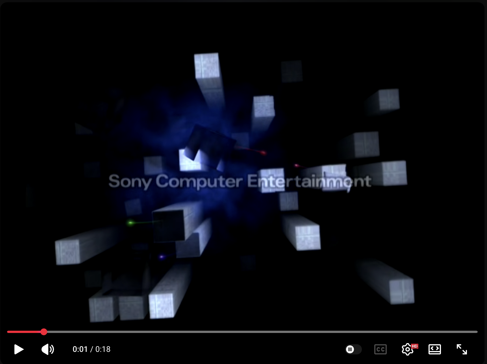

# PlayStation 2 System Menu (C++20 Native)

A native macOS recreation of the iconic **PlayStation 2 (PS2) BIOS & System Configuration UI**, written in **C++20** with **SDL2**, **OpenGL (Retina High-DPI + 4x MSAA)**, and **macOS CoreText** anti-aliased typography.

Designed as an interactive desktop app launcher that maps your local directories to populate the PS2 **Boot Towers** and **Browser**.



> **Disclaimer:** This is an unofficial fan project. PlayStation, PS2, DualShock, and related marks are trademarks of Sony Interactive Entertainment. Not affiliated with or endorsed by Sony.

---

## Requirements

- macOS 11+ (Apple Silicon or Intel)
- [Homebrew](https://brew.sh)
- SDL2
- Xcode Command Line Tools (`clang++`)

```bash
xcode-select --install
brew install sdl2
```

---

## Features

* **Iconic PS2 Boot Sequence ("Towers in the Mist"):**
  * 3D camera dive through the monolithic gray-blue PS2 towers rising from volumetric midnight-blue mist, accompanied by the 4 descending colored light orbs and the synthesized PS2 startup swell chord + *"Sony Computer Entertainment"* reveal.
* **"The Seven Stars" (7 Swirling Light Orbs):**
  * 7 additive-blended (`GL_ONE`) glowing light orbs orbiting in 3D Lissajous patterns with 52-segment tapered light ribbons and corona halos.
* **Crisp Retina Typography (`CoreText` + `CoreGraphics`):**
  * TrueType vector font rasterization with soft outer bloom and drop shadows at native Retina resolution.
* **PS2 Browser (Local App & Game Launcher):**
  * Displays 3D **Memory Card (8MB) Slot 1 & Slot 2** and a spinning **3D PlayStation 2 Format DVD-ROM Disc**.
  * Scans your mapped local directories (`/Applications`, `~/Applications`, `~/Games`, or custom folders) for `.app` bundles and disc images (`.iso`, `.bin`, `.chd`, `.elf`, `.gcm`, `.rvz`).
  * Pressing **Cross (`✕` / `Enter`)** spins up the 3D optical disc and launches the application natively on macOS.
* **Directory Mapper with Native macOS Finder Dialog:**
  * Press **Triangle (`△` / `V`)** to open a native macOS Finder folder picker dialog and mount any directory on your Mac.
* **System Configuration:**
  * Features the iconic rotating 3D translucent crystal octahedron and 12-point orbital clock ring alongside live RTC readout, Stereo/Mono/Surround toggles, Ocean Surf ambience toggle, and Left/Right speaker harmonic chime tests.
* **Plug-and-Play DualShock / Gamepad Support:**
  * Automatic controller hotplugging with an on-screen **"CONTROLLER CONNECTED (PORT 1)"** pop-up banner.

---

## Controls

| Action | PlayStation / Gamepad | Keyboard / Mouse |
| :--- | :--- | :--- |
| **Navigate Menu / Browser** | Left Stick / D-Pad | `Up` / `Down` / `W` / `S` / Mouse Wheel |
| **Enter / Launch App** | **Cross (`✕`)** (Bottom Button) | `Enter` / `Space` / `Z` / Left Click |
| **Back / Return** | **Circle (`○`)** (Right Button) | `Escape` / `Backspace` / `X` |
| **Map Folders / Finder Dialog** | **Triangle (`△`)** (Top Button) | `V` |
| **Switch Memory Slot / Remove Dir** | **Square (`□`)** (Left Button) | `C` / `Left` / `Right` |

---

## Build & Run

```bash
make run
```

Build a standalone macOS `.app` bundle:

```bash
make bundle
open PS2.app
```

Clean build artifacts:

```bash
make clean
```

---

## Project layout

```
src/                 C++ sources and headers
docs/images/         Screenshots
.cursor/skills/      Cursor skills (e.g. package-native-release)
Makefile             Build + .app bundling
```
---

## License

No license file is included yet. Add one (for example MIT or Apache-2.0) before publishing if you want others to reuse the code.
